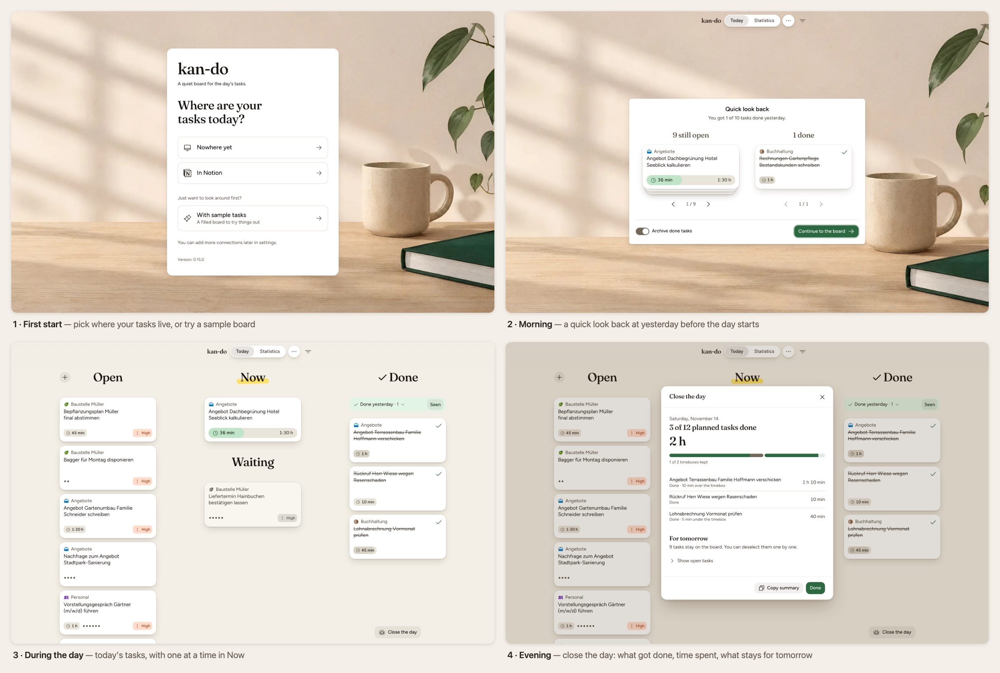
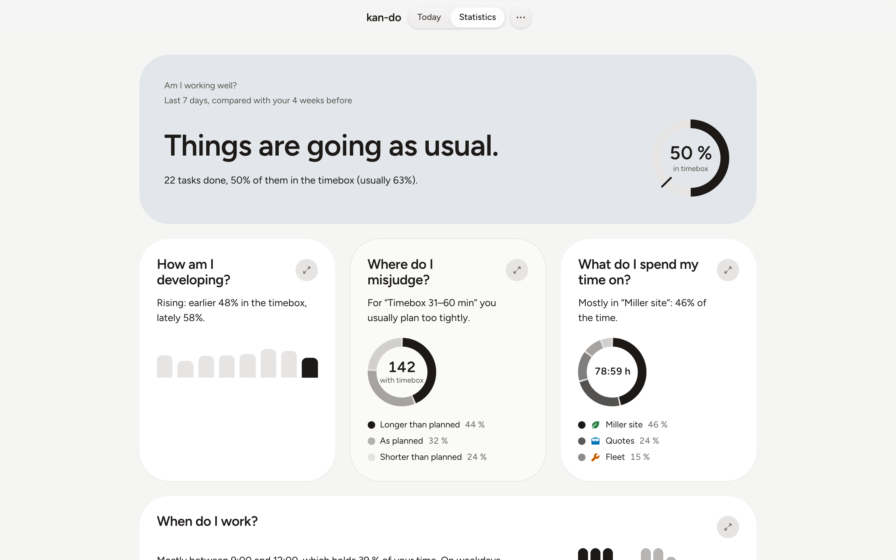

# kan-do

A calm personal kanban board for today's work. Kan-do is an opinionated focus layer on top of your existing tasks (Notion or tasks kept in the app itself): it shows only what you chose for today, lets you work on one thing at a time, and helps you close the day with fewer things in flight. It is not a second task manager to maintain.

It is built for one person managing their own day: short, frequent sessions where you glance, move a card, check a timer and close.

> **Status: alpha.** Though well tested and in daily use by its maintainer, it does not yet keep its promise yet: Notion is the only one you can connect, and that connection still has gaps; Todoist is planned. Also, UI design still has some rough edges and there are frequent partly changes between versions.

**Platforms:** a macOS desktop app (Apple silicon) and a web app (Nuxt), built from the same code.

Want to help build kan-do? See [CONTRIBUTING.md](CONTRIBUTING.md).





<sub>A day with kan-do, from first start to closing the day. Screenshots of the demo board with the English interface. The demo tasks ship in German; they were shown in English here.</sub>

## What you get

- **A board for today only.** Four columns in a fixed order: **Open**, **Now**, **Waiting**, **Done**. Drag a card, or move it by keyboard.
- **One task in Now.** The Now column accepts a single task, so the thing you are doing right now is unambiguous.
- **Timeboxes and time tracking.** Set a timebox on a task (presets, with an automatic suggestion), run its timer while it is in Now, and see the time spent.
- **A rhythm for the day.** An optional "Close the day" at the end of the day, and a short recap ("Quick look back") the first time you open the app on a new day. Yesterday's finished tasks are acknowledged before they leave the board.
- **Statistics.** A statistics page shows how your days went, so you can plan better ones.
- **Your tasks, your source.** Connect a Notion database or use local tasks, or both side by side on one board. Todoist support is planned and not offered in the app yet.
- **Works offline.** The local copy is authoritative while you have no connection and reconciles when you are back online.
- **German and English.** The interface is German by default and English when your browser or system prefers it (add `?lang=en` to the address to switch).
- **Mobile friendly.** The web app works down to phone width.

## Using kan-do

### Install the desktop app

Download the latest `.dmg` from the [releases page](https://github.com/jaylouiz/kan-do/releases/latest), open it and drag the app into *Applications*. Builds are for Apple silicon Macs.

### Web app

Run it from source (see [Build from source](#build-from-source)) or deploy it to your own host, then open it in a browser. On first start, the welcome page lets you pick where your tasks come from, or try a sample board.

### macOS desktop app

The desktop app is the same board in its own window, plus a few desktop-only features:

- your data lives in a plain file in a folder you can choose (for example a cloud-synced one), with automatic backups and protection against overwriting newer data;
- API tokens are stored in the macOS Keychain, not in the data file;
- a built-in updater: the app checks for new versions, asks you, backs up your data, installs the update and relaunches. After an update it can show you what is new.

The first install of an ad-hoc signed build needs a right-click on the app and "Open" once; details in [docs/release.md](docs/release.md) ("First install from the DMG").

The app checks for updates on its own and installs them after asking; no GitHub account or token is needed.

### Connecting Notion

Notion is optional. From the welcome page, or from the board settings under task sources, choose **Notion** and follow the setup wizard: connect your integration, pick the database, and map its properties to kan-do's status and fields. You can also map extra Notion properties (text, number, select, multi-select, date, checkbox, URL, email, phone) so they show in the task's detail view, and choose the unit (seconds, minutes, hours) for time spent.

### Local tasks

No setup needed. Add tasks directly on the board; they are stored on your device (in the browser for the web app, in the data file for the desktop app).

## Your data and privacy

- Local tasks and settings stay on your device. The desktop app keeps them in a data file in a folder you choose (by default `~/Library/Application Support/io.github.jaylouiz.kan-do/`).
- The desktop app keeps API tokens in the macOS Keychain, never in the data file.
- Task text is masked in screenshots attached to in-app feedback.
- Details for the curious: [ADR 007](docs/adr/007-secrets-keychain.md) (secrets) and [ADR 008](docs/adr/008-file-backed-persistence.md) (data file).

## Build from source

You need Node.js (current LTS) and npm; for the desktop app also the Rust toolchain and the Tauri CLI (`cargo install tauri-cli`).

```bash
git clone https://github.com/jaylouiz/kan-do.git
cd kan-do
npx npm@11.19.0 ci
npm run dev            # web app on http://localhost:3000 (try /tasks?seed=demo)
npm run build          # web build; see CONTRIBUTING.md for hosting options
npm run tauri:build    # macOS app bundle and DMG in src-tauri/target/release/bundle/
```

Notion is optional and configured in the app; `.env.example` lists the variables for development against Notion or Todoist. Details, tests and conventions: [CONTRIBUTING.md](CONTRIBUTING.md).

## More about the product

- [PRODUCT.md](PRODUCT.md): who kan-do is for and the principles behind it.
- [docs/application-purpose.md](docs/application-purpose.md): vision and non-goals.

## License

Kan-do is released under the [MIT License](LICENSE). Copyright (c) 2026 Julius Wüstefeld.

The interface font is [Figtree](https://github.com/erikdkennedy/figtree) by Erik Kennedy, licensed under the SIL Open Font License 1.1 ([public/fonts/Figtree-OFL.txt](public/fonts/Figtree-OFL.txt)). The heading font is [Fraunces](https://github.com/undercasetype/Fraunces) by Undercase Type, under the same licence ([public/fonts/Fraunces-OFL.txt](public/fonts/Fraunces-OFL.txt)).
