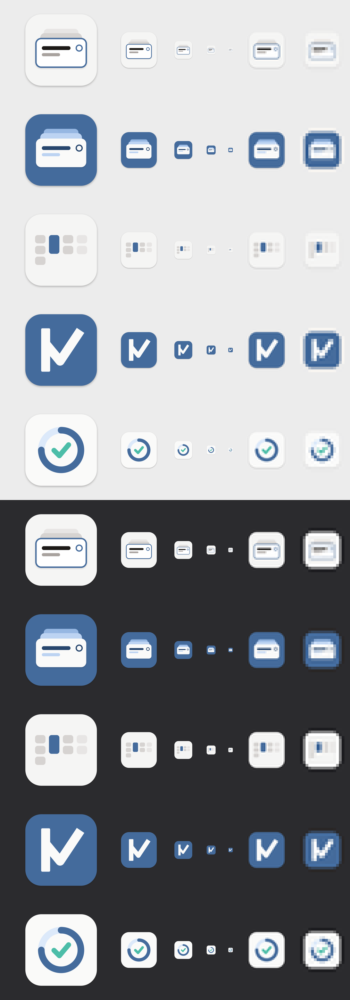

# App icon (#263)

Status: **final icon chosen: artboard 6 of `kan-do-app-icon.vectorcraft`** (`kan-do-icon-final.svg`/`.png`, 1024 px, macOS margin). It is wired into `src-tauri/icons/` (via `cargo tauri icon`) and `public/favicon.svg` + `favicon.ico` (cropped to the rounded square, no margin). The five variants below are the milestone 1 exploration.

The contact sheet shows one row per variant: 256 px (scaled down), then 128, 64, 32 and 16 px at real size, then 32 and 16 px magnified 4x. The top block is on a light Dock colour, the bottom block on a dark one.

## Final choice

Artboard 6 is not one of the five variants. Read from `kan-do-app-icon.vectorcraft` and `kan-do-icon-final.svg`, it is A1's layout redrawn in yellow:

- **Kept from A1:** a 1024 px body, one front sheet with a title bar and a note bar, and two sheets stacked behind it.
- **Changed:** the body is a yellow gradient (`#F5DA00` to `#FFD000`) instead of Paper; the stacked sheets are white at 60 % (the front sheet 88 %) instead of Rule Line and stone-300; the back sheets show only as slivers at the left and right edge of the body; both bars are yellow instead of Ink Black and Pencil.
- **Dropped:** the Desk Ink edge, the timebox ring and the C1 check. No Desk Ink or Done Teal is used.

Why: the user is not satisfied with the matte ink colour of the earlier variants. Artboard 6 is a quick alternative, an interim choice until a planned colour-scheme rework. Yellow is an icon-only exception and never appears in the app UI. Small-size behaviour is in DESIGN.md (`## App icon`).

## Files

| File | What |
|---|---|
| `kan-do-app-icon.vectorcraft` | VectorCraft source: one 1024 px artboard per variant, named after it |
| `build_variants.py` | Draws the document headlessly through `vectorcraft-cli run` (120 commands) and exports each artboard |
| `contact_sheet.sh` | Builds `contact-sheet.png` from the exports (ImageMagick) |
| `variants/*.svg`, `variants/*.png` | Per-variant export, 1024 × 1024 (the body shadow is an SVG filter) |

To rebuild, copy `build_variants.py` and `contact_sheet.sh` into the VectorCraft automation sandbox, run `python3 -I build_variants.py && sh contact_sheet.sh` there, and copy the results back. The CLI only writes inside its sandbox. Drawn with VectorCraft 0.17.0 (CLI).

## Shared frame

- macOS icon template: 1024 canvas, an 824 px rounded square (radius 185) centred with a 100 px margin, and a soft shadow (Ink Black, 30 %, y 10, blur 22).
- Colours are DESIGN.md tokens only. Ink is converted from the `--color-custom-ink-*` oklch ramp: 100 `#DCE9FA`, 200 `#BCD3F2`, 300 `#96B7E2`, 500 `#446B9C` (Desk Ink), 700 `#27466D`. Neutrals are Paper `#F5F5F4`, Sheet `#FAFAF9`, Rule Line `#E7E5E4`, stone-300 `#D6D3D1`, Pencil `#A8A29E` and Ink Black `#1C1917`.
- Flat fills. The only depth is a shadow, the same as the cards in the app.

## Variants

### A1 One Sheet, paper
The Jetzt card on the desk: one bright sheet with the 2 px ink edge of the current card (#93), a title line, a note line and a timebox ring. Two sheets are stacked neatly behind it. It is the product idea ("one sheet in front of you, the rest stacked to the side") drawn as an object.
- Tokens: Paper body, white front sheet, Desk Ink edge and ring, Ink Black title, Pencil note, Rule Line and stone-300 behind.
- Small sizes: weakest on a light Dock. Paper on light grey loses its edge, and at 16 px it becomes a pale blob with a dark line. It would need its own small-size drawing (only the front sheet, a thicker edge).

### A2 One Sheet, ink
The same scene on a Desk Ink body. "The lamp" is the whole icon, and the sheets are lit by it.
- Tokens: Desk Ink body, Sheet front card, ink-300/ink-200 stacked sheets, ink-700 title and ring, ink-200 note.
- Small sizes: holds up well down to 32 px. At 16 px it reads as "a light card on blue", which is enough. It is the most legible scene-based variant.

### B Four Columns, One Lit
The board itself: four columns (Offen, Jetzt, Wartet, Erledigt) with cards. Only Jetzt holds its single, taller ink card, the WIP-1 rule. Erledigt recedes one step lighter, like done cards in the app.
- Tokens: Paper body, stone-300 cards, Rule Line done cards, one Desk Ink card.
- Small sizes: reads as a board from 64 px up. At 32 and 16 px only the ink bar survives, and the grey cards turn to noise. It is also the most generic idea (kanban apps commonly use bars).

### C1 K-check
A monogram: a squared stem and a check that grows out of it, so the K's arm and leg become a check ("Kan-Do", can do). It is in Sheet on a Desk Ink body.
- Tokens: Desk Ink body, Sheet glyph.
- Small sizes: the strongest of the five. It stays a crisp light mark on blue down to 16 px, and it is the most distinctive in a Dock. Open point: the check reads first and the K second, and the letterform would need iteration against Figtree's geometry.

### C2 Timebox ring
The running timebox ring from the task card, three quarters full, with a check at its centre. This is the one variant with a Done Teal hint (the exploratory exception from shaping).
- Tokens: Sheet body, ink-100 track, Desk Ink progress, Done Teal (`#4CBDA8`) check.
- Small sizes: the ring reads down to 32 px. At 16 px the check fades into the ring. Teal next to ink makes two accents, which breaks *The One Lamp Rule* and *Status Is Not Decoration* if the variant wins as it is. An ink check would keep the rules.

## Designer's read

C1 and A2 are the strongest candidates: C1 for recognition at every size, A2 for telling the product story. A hybrid is possible (an A2 front sheet carrying the C1 check as its "title"). Whatever wins needs a small-size version (16/32 px, full bleed, no shadow) for the favicon and the Windows icons in milestone 2.
